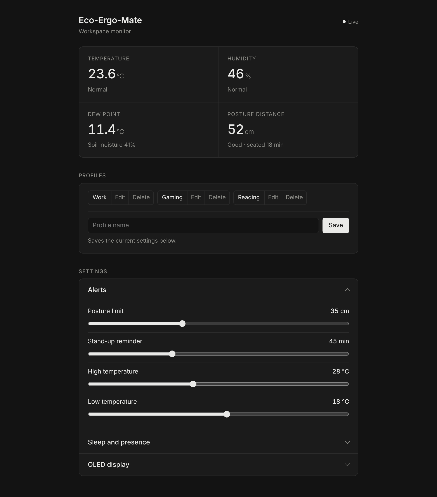

Eco-Ergo-Mate
An ESP32 desk monitor that tracks your workspace and your posture. It shows live readings on a small OLED screen and on a web dashboard you open from any device on the same Wi-Fi network.
Features
• Temperature, humidity and dew point from a DHT22 sensor
• Soil moisture for a desk plant
• Posture distance from an ultrasonic sensor, with a "sit up" alert when you lean too close
• Stand-up reminder after you've been sitting for a set time
• Auto sleep when no one is at the desk, triggered by a PIR motion sensor or by distance
• Web dashboard with live data, adjustable alert limits, OLED display options and saved setting profiles
• Publishes readings over MQTT
Hardware
Part
Pin
Soil moisture sensor (analog)
GPIO 2
DHT22 temperature and humidity sensor
GPIO 4
HC-SR04 ultrasonic sensor, trigger
GPIO 5
HC-SR04 ultrasonic sensor, echo
GPIO 6
PIR motion sensor
GPIO 7
SSD1306 OLED 128x64, SDA
GPIO 8
SSD1306 OLED 128x64, SCL
GPIO 9
You'll also need an ESP32 development board.
Libraries
Install these from the Arduino Library Manager:
• Adafruit GFX Library
• Adafruit SSD1306
• DHT sensor library (Adafruit)
• NewPing
• PubSubClient
WiFi and WebServer come with the ESP32 board package.
Setup
1. Open Eco_Ergo_Mate/Eco_Ergo_Mate.ino in the Arduino IDE.
2. Enter your Wi-Fi name and password in ssid and password.
3. Select your ESP32 board and port, then upload.
4. Open the Serial Monitor at 115200 baud to find the board's IP address.
5. Open that IP address in a browser on the same network.
MQTT
Readings are published to broker.hivemq.com on these topics:
• ecoergo/posture
• ecoergo/temperature
• ecoergo/humidity
• ecoergo/dewpoint
Dashboard preview
eco_ergo_mate.html is a standalone copy of the dashboard. Open it in a browser to see the layout. It shows no live data without the board.
To show a screenshot here, upload screenshot.png to the repo and add this line:

Note
The hardware was built and tested in 2025. The dashboard was redesigned in 2026 and has not been tested on the hardware.
